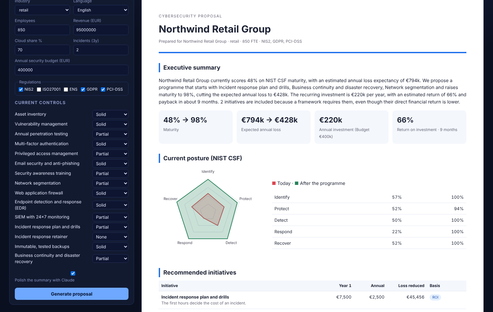
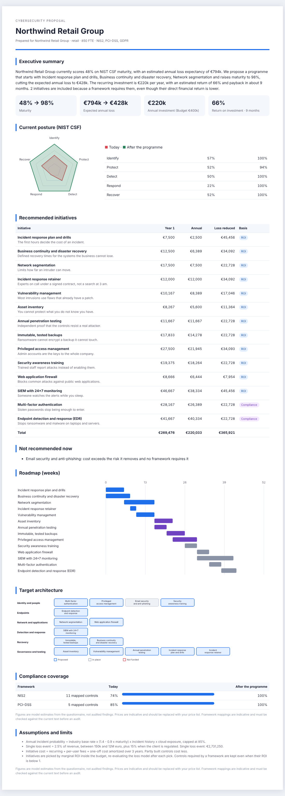
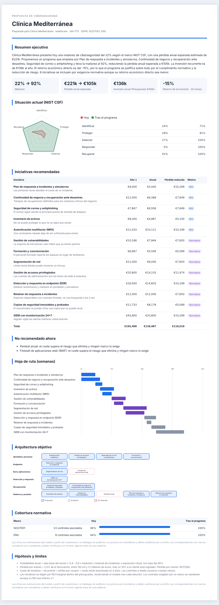

# Pre-Sales Studio

Fill in a client questionnaire and get a **client-ready security proposal**: NIST CSF maturity, quantified risk, a budget-constrained initiative plan with ROI and payback, roadmap, target architecture, and compliance coverage for NIS2, ISO 27001, ENS and PCI-DSS. English or Spanish. Web UI, CLI, HTML, Markdown and JSON output.

Strict TypeScript, **zero runtime dependencies**, 43 tests.



## The design rule: the model writes, the engine counts

An LLM is good at prose and unreliable at arithmetic, and a proposal with an invented number is worse than no proposal. So:

1. All figures (maturity, expected loss, costs, ROI, payback, coverage) come from a deterministic engine.
2. Claude may only polish the **executive summary**, receiving pre-formatted facts and being told to copy figures exactly.
3. The answer is accepted only if **every number in it appears in those facts** and it contains no markup or links. Otherwise a built-in template is used, in either language. A proposal is always produced and always consistent.
4. Client names are passed as quoted data. Everything rendered is HTML-escaped, and the proposal is served with a CSP that forbids scripts.

## How the numbers are built

- **Maturity**: 15 controls across the five NIST CSF functions, each rated 0 to 3 and weighted. Per-function scores feed a radar chart.
- **Risk**: `probability = industry base rate x (1.4 - 0.9 x maturity) x incident history x cloud exposure` (capped at 85%); `single loss = 2.5% of revenue` (bounded, plus 15% if regulated); `ALE = probability x single loss`. All constants live in `src/catalog.ts` as `ASSUMPTIONS`, and the proposal prints them.
- **Plan**: greedy selection by **marginal ROI** inside the annual budget. The loss model is re-evaluated after every pick, so overlapping controls are not double counted. Half-built controls cost less to finish.
- **Honesty about ROI**: a control that costs more than the risk it removes is dropped, unless a framework the client is subject to requires it. Those are labelled *Compliance* instead of *ROI*, and the summary says so when the overall return is negative (see the Spanish clinic sample). Dropped items are listed with the reason.
- **Roadmap**: two parallel workstreams ordered by return, phased into 13, 26 and 52 weeks.

## Run it

```bash
npm install
npm test
npm start                                   # http://127.0.0.1:8400
node dist/src/cli.js samples/northwind-retail.json --out proposal.html
node dist/src/cli.js samples/clinica-sanitas.json --format md
```

Set `ANTHROPIC_API_KEY` to let Claude (`claude-sonnet-5-5`) polish the summary. Without it the template is used.

## Samples

| English, retail, NIS2 + PCI-DSS | Spanish, healthcare, ENS + ISO 27001 |
|---|---|
|  |  |

Input is one JSON file (`samples/*.json`): industry, headcount, revenue, regulations, cloud share, incidents, budget and a 0-3 level per control.

## Layout

```
src/model.ts     input types and strict validation (never throws)
src/catalog.ts   controls, prices, framework mappings, risk assumptions
src/risk.ts      maturity, probability, loss, costs, coverage
src/planner.ts   ROI-driven selection and roadmap
src/summary.ts   Claude summary, number validator, templates
src/render.ts    HTML (inline SVG radar, Gantt, architecture) and Markdown
src/server.ts    loopback API and UI, proposals served under a no-script CSP
```

## Limits

Prices are indicative and framework mappings are a starting point: replace the catalog with your own price list and verify clause references before an audit. The loss model is a single-scenario estimate, not an actuarial one, and it is meant to structure a conversation with the client, not to replace one.

## AI-assisted

Written with AI assistance (Claude) and reviewed and tested by the author.

## License

MIT
